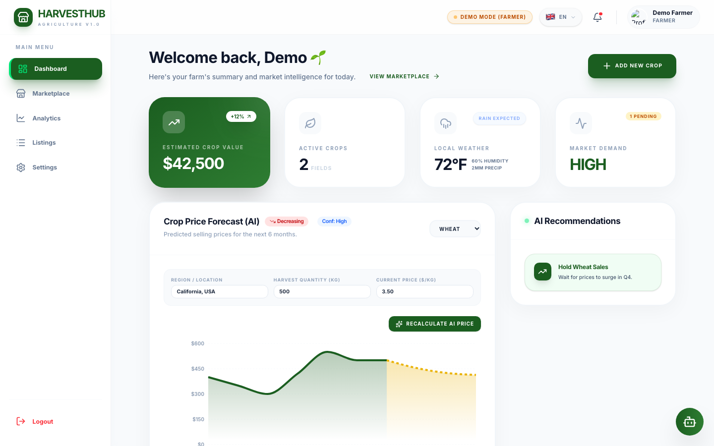
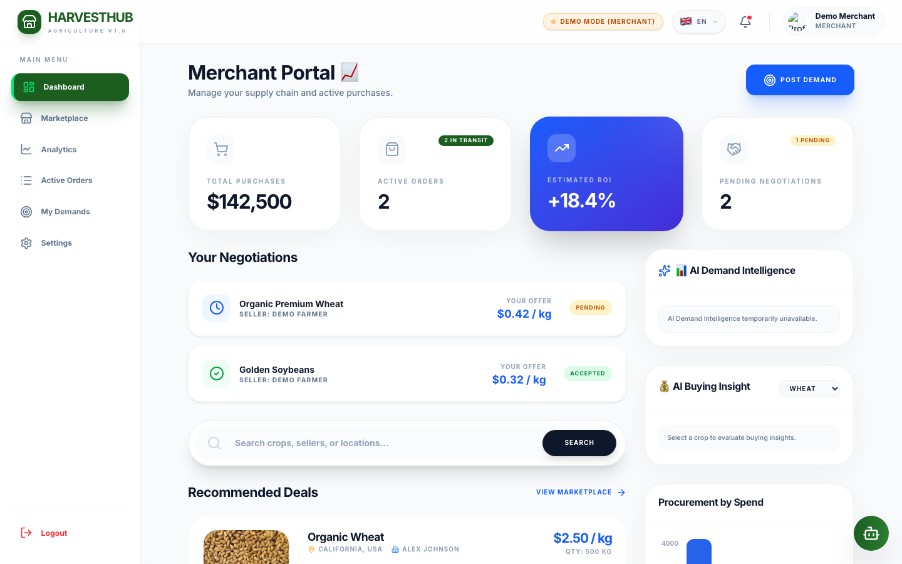
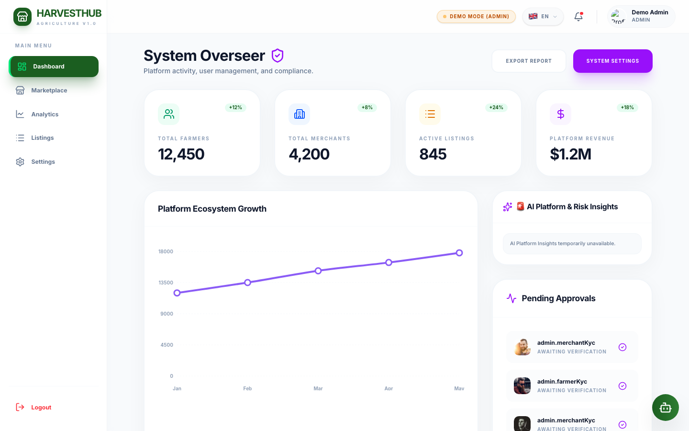
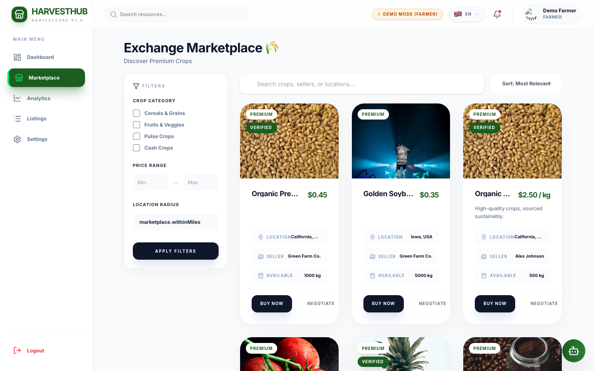
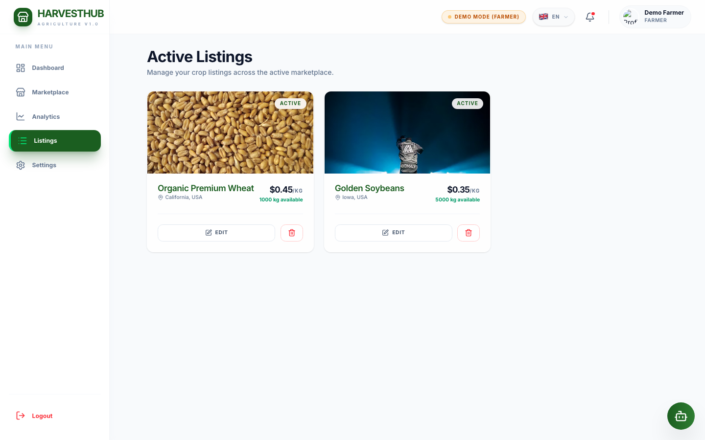
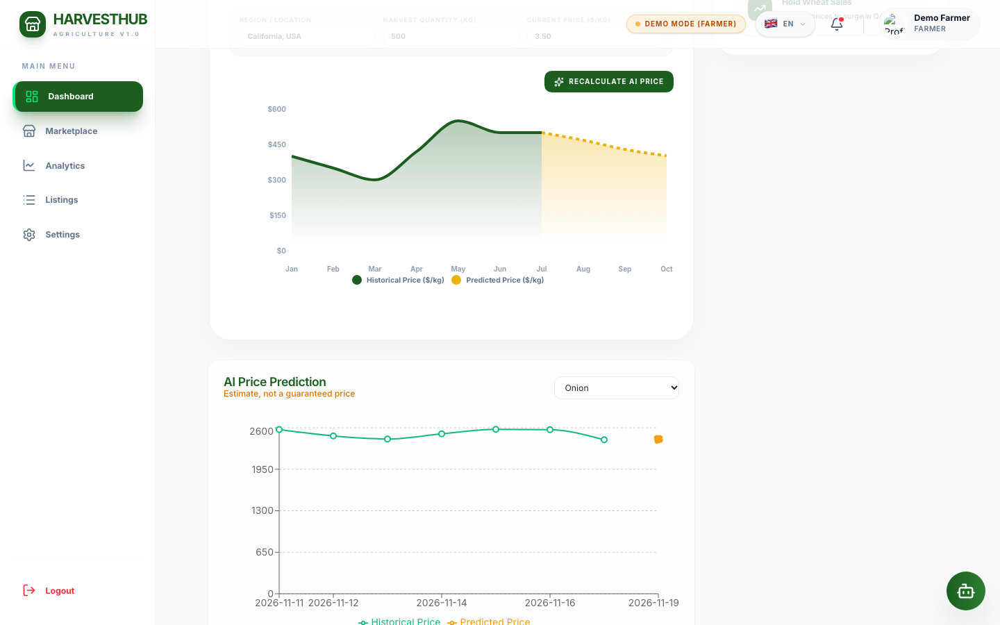
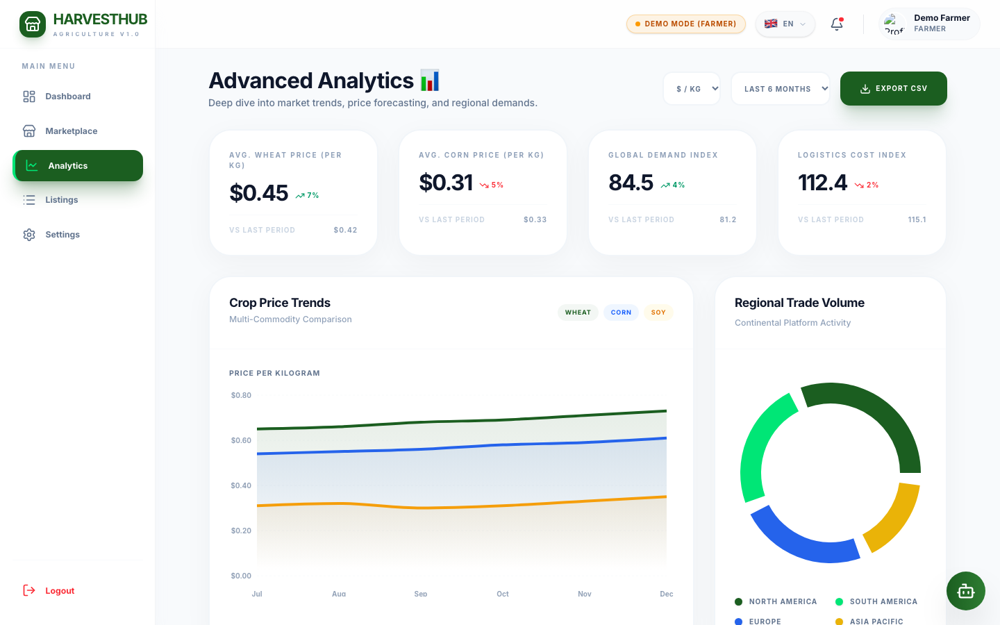
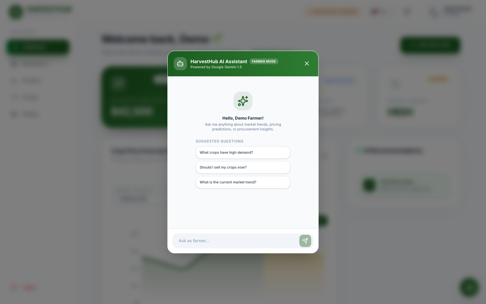

# HarvestHub – AI-Enabled Agricultural Marketplace & Decision-Support Platform

[-1B5E20?style=for-the-badge)](https://github.com/gokul7308/HarvestHub)
[](https://react.dev/)
[-emerald?style=for-the-badge)](docs/AI_MODEL_EVALUATION.md)
[-3ECF8E?style=for-the-badge)](docs/DATABASE_SCHEMA.md)
[-success?style=for-the-badge)](docs/TESTING_REPORT.md)

HarvestHub is a full-stack, AI-enabled agricultural marketplace and decision-support platform designed to connect smallholder farmers directly with agricultural merchants and bulk buyers. The platform eliminates intermediary exploitation through transparent price discovery, empirical machine learning price regression, concurrency-locked atomic trading, and database-level Row-Level Security (RLS).

---

## Table of Contents
1. [Problem Statement & Objectives](#1-problem-statement--objectives)
2. [Key Platform Features](#2-key-platform-features)
3. [User Roles & RBAC Matrix](#3-user-roles--rbac-matrix)
4. [Technology Stack](#4-technology-stack)
5. [System Architecture](#5-system-architecture)
6. [Machine Learning & AI Methodology](#6-machine-learning--ai-methodology)
7. [Database Architecture & Security](#7-database-architecture--security)
8. [Installation & Local Setup](#8-installation--local-setup)
9. [Automated Testing Suite](#9-automated-testing-suite)
10. [Documentation Links](#10-documentation-links)
11. [Platform Screenshots](#11-platform-screenshots)
12. [Known Limitations & Future Scope](#12-known-limitations--future-scope)

---

## 1. Problem Statement & Objectives

### Problem
Traditional agricultural supply chains are plagued by severe structural fragmentation:
* **Information Asymmetry:** Farmers lack predictive price foresight, forcing them into distress selling at local mandis during sudden gluts.
* **Procurement Inefficiencies:** Agricultural merchants and food processors struggle to source consistent, verified produce directly from farmers with transparent provenance.
* **Overselling & Concurrency Vulnerabilities:** Unprotected digital catalogs risk double-selling inventory under concurrent peak trading volumes.

### Objectives
* Establish a direct, disintermediated marketplace connecting verified farmers and commercial merchants.
* Deliver an empirical, supervised machine learning price regression engine ($R^2 = 0.9702$, trained on AGMARKNET-calibrated mandi data) strictly distinguished from generative text predictions.
* Guarantee ACID transaction integrity and prevent overselling via PostgreSQL stored procedures with pessimistic row locks (`SELECT ... FOR UPDATE`).
* Enforce cryptographically isolated multi-tenant privacy via PostgreSQL Row-Level Security (RLS).

---

## 2. Key Platform Features

### Farmer Features
* **Real-Time Operational Dashboard:** Live tracking of listed inventory, incoming merchant price negotiations, total trade earnings, and microclimate weather observations.
* **Crop Management System:** Add, edit, and delete crop listings with strict Zod client validation and image support.
* **Predictive Price Advisory:** View statistical modal prices, confidence bounds, and seasonal trend momentum backed by supervised ML.
* **Interactive Negotiation Portal:** Accept or counter price offers submitted by verified buyers.

### Merchant Features
* **Commercial Sourcing Hub:** Search, filter (cereals, fruits, pulses, cash crops), and inspect verified crop listings.
* **Instant Buy Checkout Modal:** Place immediate purchase orders with dynamic price calculations and inventory validation.
* **Procurement Demands:** Post custom commodity sourcing requests with target volumes and budget ceilings.
* **Order Tracking:** Track lifecycle transitions (`pending` → `In Transit` → `Delivered`).

### Administrator Features
* **Platform Health Console:** Real-time telemetry monitoring total farmers, merchants, active listings, and platform transaction volume.
* **User Management Directory:** Supervise farmer and merchant compliance records.
* **AI Market Anomaly Detection:** Automated detection of sudden price shifts and volume anomalies across regional trading hubs.

---

## 3. User Roles & RBAC Matrix

Access control is enforced at both the client routing layer and the PostgreSQL database engine:

| Capability | Farmer | Merchant | Admin | Enforced Layer |
| :--- | :---: | :---: | :---: | :--- |
| **Access Farmer Dashboard** | **YES** | No | Yes | Route Guard + Database |
| **Access Merchant Dashboard** | No | **YES** | Yes | Route Guard + Database |
| **Access Admin Console** | No | No | **YES** | Route Guard + Database |
| **Publish Crop Listings** | **YES** | No | Yes | RLS INSERT Policy on `crops` |
| **Post Sourcing Demands** | No | **YES** | Yes | RLS INSERT Policy on `demands` |
| **Instant Buy / Place Order** | No | **YES** | No | `place_order` Stored Procedure |
| **Purchase Own Listing** | **BLOCKED** | **BLOCKED** | **BLOCKED** | SQL CHECK Constraint + RPC Guard |

---

## 4. Technology Stack

* **Frontend:** React 19, TypeScript 5.9, Vite 8.0, Tailwind CSS v4, Lucide Icons, Framer Motion, Sonner Toaster
* **Data Visualization:** Recharts, Matplotlib (ML evaluation)
* **Backend Serverless API:** Vercel Serverless Functions (`/api/predict`, `/api/insights`, `/api/assistant`) & Netlify Functions (`/.netlify/functions/`)
* **Machine Learning Pipeline:** Python 3.12, scikit-learn 1.4, pandas 2.2, FastAPI, Uvicorn, Joblib
* **Generative AI Assistant:** Google Gemini 1.5 Flash (`@google/genai`)
* **Database & Auth:** Supabase PostgreSQL 15+, Passwordless Email OTP, Row-Level Security (RLS)
* **Testing:** Vitest 4.1, React Testing Library, Pytest 8.1, Playwright (UI verification)

---

## 5. System Architecture

```
[Client Devices (Desktop / Mobile)] ──HTTPS──► [React 19 SPA]
                                                    │
                 ┌──────────────────────────────────┴──────────────────────────────────┐
                 │ REST / RPC                                              JSON API    │
                 ▼                                                                     ▼
+─────────────────────────────────────────────+       +─────────────────────────────────────────────────+
|          SUPABASE POSTGRESQL TIER           |       |            SERVERLESS API LAYER (VERCEL)        |
|  • public.profiles (Auth Sync)              |       |  ├── /api/predict (Hybrid ML / AI Svc)          |
|  • public.crops (Listings)                  |       |  ├── /api/insights (Marketplace Analytics)      |
|  • public.demands (Merchant Sourcing)       |       |  └── /api/assistant (Role-Based Advisory)       |
|  • public.orders (Transactions)             |       +-------------------------------------------------+
|  • public.offers (Negotiations)             |                                │
|  • place_order() RPC (Row-Level Locking)    |              ┌─────────────────┴─────────────────┐
|  • 100% Tables Protected by RLS             |              ▼                                   ▼
+─────────────────────────────────────────────+   +--------------------+               +--------------------+
                                                  | SUPERVISED ML (RF) |               | GEMINI 1.5 FLASH   |
                                                  | • AGMARKNET-Calib.  |               | • Qualitative Adv. |
                                                  | • R²: 0.9702       |               | • Anomaly Flags    |
                                                  +--------------------+               +--------------------+
```

---

## 6. Machine Learning & AI Methodology

HarvestHub strictly separates **empirical regression modeling** from **generative language reasoning**:

1. **Supervised Regression Engine (Random Forest Regressor v3.0):**
   * **Training Data:** 16,380 synthetic records calibrated to AGMARKNET daily wholesale mandi prices (January 2025 to June 2026; 15,480 valid post-warmup records).
   * **Commodities:** Onion, Potato, Tomato, Wheat, Rice across 6 regional trading yards (Pune, Nashik, Lasalgaon, Mumbai, Azadpur, Bangalore).
   * **Feature Engineering:** Calendar cyclicality (`Month`, `DayOfWeek`, `Quarter`), backward lag momentum (`Lag_1`, `Lag_7`, `Lag_30`), and moving averages (`RollMean_7`, `RollMean_30`).
   * **Validation Strategy:** Chronological temporal split (March 19, 2026 split date).
   * **Performance:** **$R^2 = 0.9702$**, **MAE = 96.80 INR/Quintal**, **RMSE = 140.46 INR/Quintal**, **MAPE = 5.13%**.
   * **Baseline Outperformance:** **3.61% lower error** than the 7-day moving average baseline and **18.26% lower error** than the Lag-1 persistence baseline.

2. **Qualitative Generative Reasoning (Google Gemini 1.5 Flash):**
   * Translates quantitative regression metrics into actionable trade advice tailored to user personas.
   * Built with resilient fallbacks ensuring zero blank-screen crashes when external API quotas are exceeded.

---

## 7. Database Architecture & Security

* **Pessimistic Concurrency Locking (`place_order`):** Prevents overselling by locking the target crop row using `SELECT ... FOR UPDATE` within a single ACID transaction.
* **Positive Numeric CHECK Constraints:** Prevents negative prices (`price > 0`), negative stock (`quantity >= 0`), or zero budgets.
* **Self-Purchase Elimination:** Enforced via table constraints `CHECK (buyer_id != seller_id)` and checked inside `place_order`.
* **Zero Secret Leakage:** Service-role keys and Gemini API secrets reside exclusively on serverless runtimes and are never bundled into client distribution assets.

---

## 8. Installation & Local Setup

### Prerequisites
* **Node.js:** v18.0.0 or higher
* **Python:** v3.12 (optional, for local ML training microservice)
* **Package Managers:** `npm` and `uv` (or `pip`)

### 1. Clone Repository & Install Dependencies
```bash
git clone https://github.com/gokul7308/HarvestHub.git
cd HarvestHub

# Install frontend dependencies
npm install
```

### 2. Configure Environment Variables
Copy `.env.example` to `.env` in the project root:
```bash
cp .env.example .env
```
Fill in your Supabase project credentials:
```env
VITE_SUPABASE_URL=https://your-project.supabase.co
VITE_SUPABASE_ANON_KEY=your-supabase-anon-key
AI_API_KEY=your-gemini-api-key
```

### 3. Run Development Server
```bash
npm run dev
```
Open [http://localhost:5173](http://localhost:5173) in your browser. Use the **Instant Demo Access** toggles (`👨‍🌾 Demo Farmer`, `🏪 Demo Merchant`, `🛡️ Demo Admin`) for instant inspection.

### 4. Optional: Run Python ML Microservice
```bash
cd ml
./venv312/bin/python serve.py
```
Microservice will start on [http://localhost:8000](http://localhost:8000).

---

## 9. Automated Testing Suite

HarvestHub maintains a multi-tier automated test suite:

### Frontend Unit & Integration Tests (Vitest)
```bash
cd frontend
npm test
```
* **Status:** 55 passed (55) across 10 test suites (0 failures).

### Machine Learning Tests (Pytest)
```bash
./ml/venv312/bin/pytest ml/tests/
```
* **Status:** 9 passed (9) across `ml/tests/test_ml.py` (0 failures).

### Production Build Verification
```bash
cd frontend
npm run build
```
* **Status:** Built in 258ms with 0 compilation errors.

---

## 10. Documentation Links

* [Implementation Audit (Phase 1)](docs/IMPLEMENTATION_AUDIT.md)
* [System Architecture](docs/ARCHITECTURE.md)
* [AI & ML Model Evaluation Report](docs/AI_MODEL_EVALUATION.md)
* [Security & Authorization Documentation](docs/SECURITY_DOCUMENTATION.md)
* [Database Schema & Data Dictionary](docs/DATABASE_SCHEMA.md)
* [Entity-Relationship Diagram](docs/ER_DIAGRAM.md)
* [Automated Testing Report](docs/TESTING_REPORT.md)
* [Final Implementation Report](evaluation/FINAL_IMPLEMENTATION_REPORT.md)

---

## 11. Platform Screenshots

All screenshots captured from the verified running application:

| View | Screenshot |
| :--- | :--- |
| **Farmer Dashboard** |  |
| **Merchant Dashboard** |  |
| **Admin Console** |  |
| **Marketplace Catalog** |  |
| **Crop Management** |  |
| **AI Price Prediction** |  |
| **Platform Analytics** |  |
| **AI Decision Assistant** |  |

---

## 12. Known Limitations & Future Scope

### Known Limitations
* **Live Email Delivery:** In unconfigured environments, Supabase Auth uses default rate-limited SMTP. Instant demo access accounts bypass this for evaluation.
* **External Weather Telemetry:** Regional mandi weather data currently defaults to seasonal historical averages when external sensor APIs are offline.

### Future Scope
* **UPI / Automated Escrow Smart Contracts:** Smart contract integration for milestone-based disbursement upon buyer delivery confirmation.
* **IoT Cold Storage Monitoring:** Direct telemetry integration with warehouse temperature sensors for perishable vegetable storage tracking.
