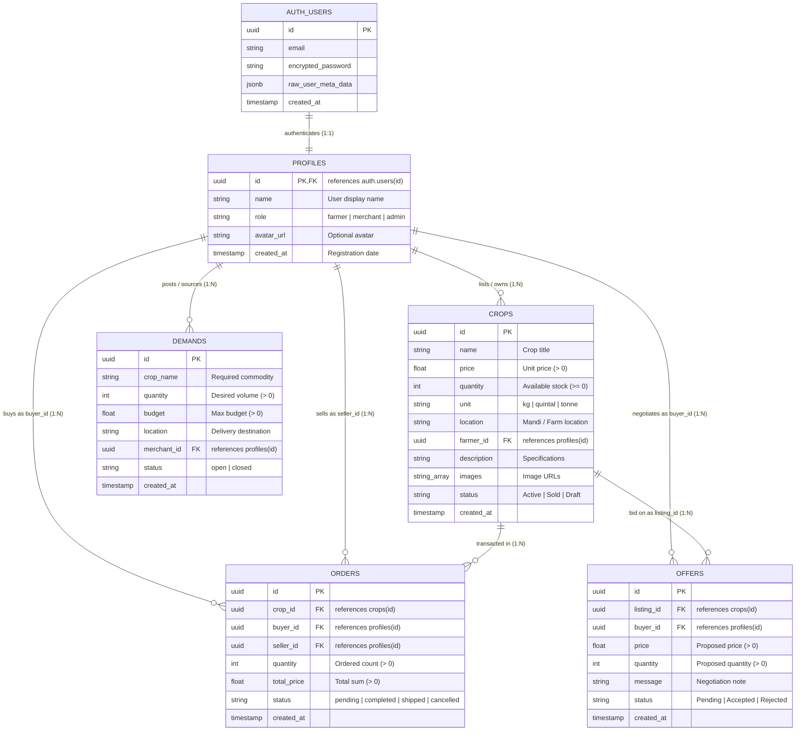

# HarvestHub – Entity-Relationship (ER) Diagram

**Document Version:** 3.0.0 (Review 3 Final Milestone)  
**Database Engine:** PostgreSQL 15+ (Supabase)  
**Date:** November 17, 2026  

---

## 1. Architectural Entity-Relationship Diagram

The diagram below reflects the exact schema, table relationships, foreign keys, and constraints implemented in `database/schema/supabase_init.sql` and `database/migrations/001_security_and_constraints_hardening.sql`:

---

## 2. Relationship Cardinality Breakdown

1. **`auth.users` to `public.profiles` (1:1):**
   * Each authenticated user in Supabase has exactly one profile row created via the `handle_new_user` PostgreSQL trigger.
   * `ON DELETE CASCADE` ensures profile deletion if an auth account is purged.

2. **`public.profiles` to `public.crops` (1:N):**
   * A user with `role = 'farmer'` can own and publish multiple active crop listings.
   * `crops.farmer_id` links to `profiles.id`.

3. **`public.profiles` to `public.demands` (1:N):**
   * A user with `role = 'merchant'` can post multiple commodity procurement requirements.
   * `demands.merchant_id` links to `profiles.id`.

4. **`public.crops` to `public.orders` (1:N):**
   * A crop listing can be partially purchased across multiple orders until quantity is exhausted.
   * `ON DELETE SET NULL` preserves historical order financial records if a crop listing is subsequently removed.

5. **`public.crops` to `public.offers` (1:N):**
   * Merchants can submit price bids against an active crop listing.
   * `ON DELETE CASCADE` removes pending offers if the parent crop listing is deleted.

6. **Self-Purchase Prevention Rule:**
   * Enforced across `orders` by `CHECK (buyer_id != seller_id)` and checked dynamically inside `place_order` stored procedure.

