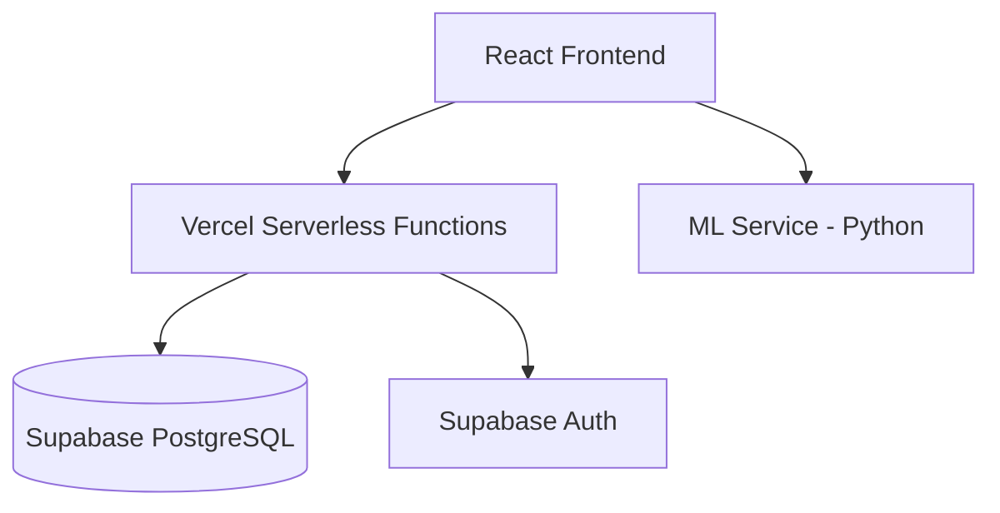

# HarvestHub Architecture Evidence

## 1. System Architecture

## 2. Roles & Permissions (RBAC) Matrix
| Role | Can View | Can Insert | Can Update | Auth Method |
|---|---|---|---|---|
| Farmer | Own crops, Market demands, Orders | Crops, Negotiate | Own crops, Orders (shipped) | Supabase Auth + RLS |
| Merchant | All crops, Own demands, Orders | Demands, Orders (buy) | Demands, Orders (complete) | Supabase Auth + RLS |
| Admin | All system data | Users, Settings | Users, Settings | Supabase Auth + RLS |

## 3. Data Model (Core)
- **users**: id, name, role, location, verified
- **crops**: id, farmer_id, name, quantity, price, unit
- **orders**: id, buyer_id, seller_id, crop_id, quantity, total_price, status

## 4. API Endpoints
- `POST /api/predict`: Predicts future crop prices using ML service.
- `POST /api/insights`: Returns actionable insights for a given role.
- `POST /api/assistant`: AI Assistant (Gemini) endpoint.

## 5. Security Posture
- All DB operations protected by RLS (Row Level Security).
- Atomic operations for order placement via `place_order` RPC.
- React Error Boundary at root level.

## 6. Implementation Status (Review 2 Audit)

### Implemented and Tested
- Zod API Validation (strict bounds)
- React Error Boundaries
- Client-Side RBAC Guards
- Context and UI Mapping to `crops`

### Implemented but Not Integration-Tested
- `place_order` PostgreSQL Atomic RPC
- Supabase Row-Level Security
- Python ML Pipeline (`ml/train.py`)

### Partially Implemented
- API Security (Lacks Rate Limiting)
- Strict TypeScript Mode (125 remaining eslint problems due to unused imports/`any`)

### Planned
- Live Inference API integration
- Staging DB integration tests
